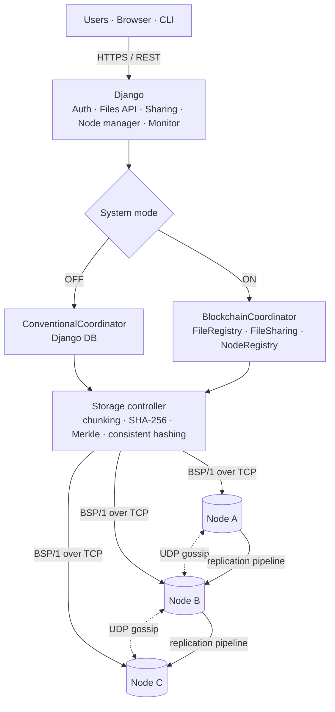

# 🧊 BlockShare — Modular Distributed File-Sharing System

**A full-stack distributed file-sharing cloud built with Django, in which the control plane can be switched between a conventional centralized coordinator (Django) and a decentralized one (Ethereum smart contracts), while the file data always stays chunked and replicated across networked storage nodes.**

[](https://github.com/PragnyaKhandelwal/BlockShare/actions/workflows/ci.yml)
[](https://render.com/deploy?repo=https://github.com/PragnyaKhandelwal/BlockShare)

> Project-Based Learning (PBL) · B.Tech CSE, 3rd year, 5th semester · Jaypee Institute of Information Technology, Noida
> One project, three subjects: **Blockchain Development · Computer Networks · Full Stack Development (24B15CS314)**
>
> Team (batch F-8): **Pragnya Khandelwal · Pratishtha Singh · Ashu Gupta**

```
Blockchain OFF:  centralized coordination  (Django)           + distributed storage
Blockchain ON:   decentralized coordination (smart contracts)  + distributed storage
```

---

## Contents
- [What it does](#what-it-does)
- [Architecture](#architecture)
- [Where each subject lives](#where-each-subject-lives)
- [Run it locally](#run-it-locally)
- [Deploy](#deploy)
- [Tests](#tests)
- [Repository layout](#repository-layout)
- [Detailed reports](#detailed-reports)

## What it does

| | |
|---|---|
| 👤 Accounts | register / log in; every user automatically gets an Ethereum wallet |
| ⇪ Upload | drag & drop; the file is split into chunks, SHA-256 hashed, placed by consistent hashing and replicated over a custom TCP protocol |
| ⇩ Download | parallel chunk fetch with failover, per-chunk hash check, Merkle root check against the coordinator |
| ⇄ Sharing | read / read-write grants, revoke, ownership transfer — enforced by Django **or** by the `FileSharing` contract |
| ⎇ Versions | every upload of a new version = new Merkle root; on-chain version chain V1 → V2 → V3 |
| ✔ Integrity | deep verification of every replica, on-chain `verifyRoot()` and per-chunk Merkle proofs (`verifyChunk()`), automatic read repair |
| ⬡ Nodes | live topology, RTT graphs, UDP gossip view, add / drain / remove nodes, simulate crashes and latency |
| ⇅ Transfers | throughput per transfer and a frame-by-frame log of the BSP/1 protocol |
| ⛓ Chain explorer | contracts, blocks, decoded events, wallets, gas per function, latency comparison of the two modes |
| ⚙ Control panel | **one-click Conventional ⇄ Blockchain switch**, chunk size, replication factor, repair, garbage collection |
| {} REST API | full API with token auth and Swagger UI at `/api/docs/` |
| ⌨ CLI | `cli/blockshare_cli.py` downloads and verifies files **directly from the chain and the nodes — works even when Django is down** |

## Architecture



* **Control plane** (who owns a file, who can access it, which versions exist, what their hash is) — pluggable: `coordination/conventional.py` or `coordination/blockchain.py`, both implementing `coordination/base.py::Coordinator`.
* **Data plane** (where the bytes are) — identical in both modes: storage nodes in `storage_node/`, driven by `storage/controller.py`.
* Blockchain is **not** a security add-on: when it is ON, the contracts are the authority. A forged permission row in Django's database grants nothing (see `tests/test_app.py::test_contract_is_the_authority`).

## Where each subject lives

| Subject | Main code | Highlights | Report |
|---|---|---|---|
| **Blockchain Development** | `blockchain/contracts/*.sol`, `blockchain/test`, `coordination/` | 3 Solidity contracts (registry, sharing, node directory), Hardhat test suite, per-user wallets signing transactions, on-chain Merkle proofs, events & gas analytics, mode switch with state reconciliation, read-only JSON-RPC proxy, Django-free CLI | [docs/BLOCKCHAIN.md](docs/BLOCKCHAIN.md) |
| **Computer Networks** | `storage_node/`, `storage/` | custom binary protocol **BSP/1** over TCP (72-byte header, framing, CRC-32, HMAC), chain-replication pipeline, UDP gossip heartbeats with loss estimation, hand-written HTTP/1.1 server, RTT probing & failure detection, consistent hashing, parallel transfers, fault & latency emulation, multi-host Docker network | [docs/COMPUTER_NETWORKS.md](docs/COMPUTER_NETWORKS.md) |
| **Full Stack Development** | `web/`, `api/`, `templates/`, `static/`, `files/`, `accounts/` | Django MVC, relational schema, auth, REST API (DRF + OpenAPI), responsive UI with drag-and-drop upload & charts, admin, service layer, tests, CI, Docker deployment | [docs/FULL_STACK.md](docs/FULL_STACK.md) |

A 10-minute demo script for the viva: [docs/DEMO_GUIDE.md](docs/DEMO_GUIDE.md).

## Run it locally

Requirements: Python 3.11+, Node.js 18+ (only for the local Hardhat chain).

```bash
git clone https://github.com/PragnyaKhandelwal/BlockShare.git
cd BlockShare
python -m venv .venv
.venv\Scripts\activate            # Windows   (Linux/macOS: source .venv/bin/activate)
pip install -r requirements.txt
cd blockchain && npm install && cd ..

python scripts/dev.py             # chain + 3 storage nodes + monitor + Django
```

Open http://127.0.0.1:8000 and log in as `alice` / `blockshare123` (also `bob`, `charlie`; admin: `admin` / `admin12345` locally).
`dev.py` starts a Hardhat node (`:8545`), three storage nodes (TCP `9101-9103`, UDP `10101-10103`, HTTP `9301-9303`), the monitor and Django; the contracts are deployed automatically.

### As separate network hosts (Docker Compose)

```bash
docker compose up --build
```

Seven containers on the private network `172.28.0.0/24`: PostgreSQL, an Anvil chain, `node-a/b/c` (172.28.0.11-13), web and monitor. Node status pages: http://localhost:9301/stats, :9302, :9303.

### On real machines (LAN)

```bash
# on each storage PC
python -m storage_node --node-id node-b --port 9000 --advertise-host 192.168.1.102 --peers 192.168.1.101:10000 --cluster-key <secret>
```
then add the node on the *Storage Nodes* page (admin), or list it in `BLOCKSHARE_NODES`.

## Deploy

**Render (free, one click):** press the *Deploy to Render* button above (or *New → Blueprint* and pick this repo). `render.yaml` builds the all-in-one `Dockerfile`: Anvil blockchain, 3 storage nodes, monitor and Django/Gunicorn in one container under supervisord. You'll be asked for `ADMIN_PASSWORD`. The free tier has an ephemeral disk, so the demo data resets when the service restarts.

**Any Docker host:**
```bash
docker build -t blockshare .
docker run -p 8000:8000 -e SECRET_KEY=... -e ADMIN_PASSWORD=... blockshare
```

**Public testnet:** set `BLOCKCHAIN_RPC_URL` (e.g. Sepolia), `BLOCKCHAIN_OPERATOR_KEY` (funded key) and `BLOCKCHAIN_EXPLORER_TX_URL=https://sepolia.etherscan.io/tx/`. See [.env.example](.env.example) for all settings.

## Tests

```bash
cd blockchain && npx hardhat test          # 10 smart-contract tests
python manage.py test tests                # 24 tests: protocol, cluster, ring, Merkle, services, API, pages,
                                           #           blockchain mode (when a chain is running on :8545)
```
GitHub Actions runs the contract tests, the backend suite against a real Hardhat node, and the Docker build on every push.

## Repository layout

```
blockchain/          Hardhat project: contracts/, test/, scripts/ (deploy, ABI export)
storage_node/        storage node: BSP/1 protocol, asyncio TCP/UDP/HTTP server, client
storage/             cluster model, consistent-hash ring, storage controller, monitor
coordination/        Coordinator interface, conventional + blockchain coordinators, web3 client, Merkle tree, ABIs
files/               files, versions, chunks, shares, transfers + service layer (use-cases)
accounts/            user wallets
core/                system config, mode switch, bootstrap & monitor commands
api/                 REST API (DRF)
web/ templates/ static/   web UI
cli/                 Django-free command-line client
deploy/  Dockerfile  docker-compose.yml  render.yaml
docs/                subject reports and demo guide
tests/               Python test suite
```

## Detailed reports
- [Blockchain Development](docs/BLOCKCHAIN.md)
- [Computer Networks](docs/COMPUTER_NETWORKS.md)
- [Full Stack Development](docs/FULL_STACK.md)
- [Demo guide](docs/DEMO_GUIDE.md)

## License
MIT — see [LICENSE](LICENSE).
