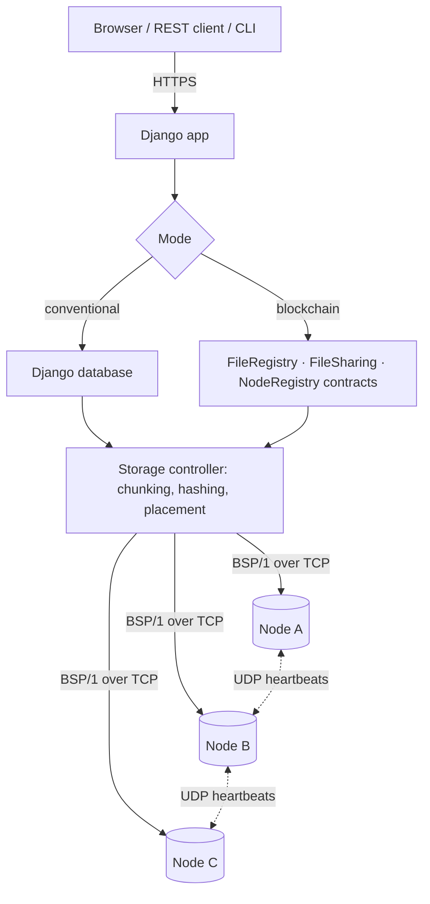

# BlockShare

BlockShare is a file-sharing system that stores files across a small cluster of storage nodes instead of on one server. Each upload is split into chunks, the chunks are hashed and replicated over the network, and a coordinator keeps track of who owns each file and who is allowed to read it.

The coordinator can be one of two things, and an administrator can switch between them while the system is running:

- **Conventional mode** — the Django server and its database decide ownership and permissions.
- **Blockchain mode** — Ethereum smart contracts decide. Each user signs their own transactions with a wallet that the app creates for them.

The storage layer is the same in both modes. Only the part that answers "who owns this, who can open it, which version is current" changes.

**Live demo:** https://blockshare-e16c.onrender.com — sign in as `alice`, `bob` or `charlie` with the password `blockshare123`. The demo runs on Render's free tier, so the first request after a quiet period can take up to a minute while the service wakes up, and demo data is reset whenever it restarts.

[](https://github.com/PragnyaKhandelwal/BlockShare/actions/workflows/ci.yml)

## About the project

This is our project-based learning (PBL) assignment for the 5th semester of B.Tech CSE at Jaypee Institute of Information Technology, Noida. The same project is submitted for three courses — Blockchain Development, Computer Networks and the Full Stack Development Lab (24B15CS314) — so each of those areas has a substantial part of the code and its own write-up in [`docs/`](docs).

Team (batch F-8): Pragnya Khandelwal, Pratishtha Singh and Ashu Gupta.

## How it works



When a file is uploaded, the server cuts it into fixed-size chunks (1 MB by default) and names each chunk by its SHA-256 hash. A consistent-hashing ring picks which nodes hold each chunk. The chunk is sent once to the first node, which forwards it to the next replica, and so on. The chunk hashes are combined into a Merkle root that identifies that exact version of the file. Finally, the file is registered with the active coordinator — as rows in the database, or as a `registerFile` transaction signed by the uploader.

On download, the coordinator checks the reader's permission and the registered Merkle root. Chunks are then fetched from the nodes in parallel. If a replica is missing or doesn't match its hash, the next replica is used and the bad one is repaired.

### Blockchain

Three contracts in [`blockchain/contracts`](blockchain/contracts), written in Solidity and tested with Hardhat:

- `FileRegistry` — file owners, the version history with a Merkle root per version, ownership transfer, and Merkle-proof verification of individual chunks.
- `FileSharing` — read and write grants, revocation, and permission checks.
- `NodeRegistry` — the list of storage nodes, so clients can find the data without the web server.

When the administrator turns blockchain mode on, existing files are anchored on-chain: owners, versions and grants are replayed as transactions. Files never go on-chain; only hashes and identifiers do. A small CLI ([`cli/blockshare_cli.py`](cli/blockshare_cli.py)) can download and verify a file using only the chain and the storage nodes, which shows that the system keeps working when Django is down. Details: [docs/BLOCKCHAIN.md](docs/BLOCKCHAIN.md).

### Computer networks

The storage nodes ([`storage_node/`](storage_node)) are asyncio servers that speak a binary protocol we designed, BSP/1. It uses a 72-byte header with length-prefixed framing, CRC-32 and an HMAC tag, and runs over TCP. Nodes send each other UDP heartbeats and spread membership by gossip. Each node also serves a small hand-written HTTP/1.1 status page. The server-side monitor measures round-trip times, marks unresponsive nodes as down, and re-replicates their chunks. From the admin screens you can crash a node or add latency to watch this happen. Details: [docs/COMPUTER_NETWORKS.md](docs/COMPUTER_NETWORKS.md).

### Full stack

The application is Django with Django REST Framework. It has server-rendered pages (dashboard, files, sharing, versions, transfers, nodes, chain explorer, control panel), a token-authenticated REST API documented at `/api/docs/`, and a service layer shared by the UI and the API. Tests run in GitHub Actions, and the app ships as a Docker image. Details: [docs/FULL_STACK.md](docs/FULL_STACK.md).

## Running it locally

You need Python 3.11 or newer and Node.js 18 or newer. Node is only used for the local Hardhat chain.

```bash
git clone https://github.com/PragnyaKhandelwal/BlockShare.git
cd BlockShare
python -m venv .venv
.venv\Scripts\activate          # on Linux/macOS: source .venv/bin/activate
pip install -r requirements.txt
cd blockchain && npm install && cd ..
python scripts/dev.py
```

`scripts/dev.py` starts these, all on your machine:

- a Hardhat chain on port 8545
- three storage nodes (TCP 9101–9103, UDP 10101–10103, HTTP 9301–9303)
- the node monitor
- Django at http://127.0.0.1:8000

The contracts are deployed automatically. The local admin login is `admin` / `admin12345`.

To run every component as its own host on a private Docker network (PostgreSQL, chain, three nodes, web and monitor), use:

```bash
docker compose up --build
```

To use real machines on a LAN, start a node on each one and add it from the Storage nodes page:

```bash
python -m storage_node --node-id node-b --port 9000 --advertise-host 192.168.1.102 --peers 192.168.1.101:10000 --cluster-key <shared secret>
```

## Deployment

The live demo is deployed on Render from [`render.yaml`](render.yaml). The [`Dockerfile`](Dockerfile) builds a single container that runs everything under supervisord: an Anvil chain, three storage nodes, the monitor, and Django behind Gunicorn. Any Docker host works the same way:

```bash
docker build -t blockshare .
docker run -p 8000:8000 -e SECRET_KEY=... -e ADMIN_PASSWORD=... blockshare
```

To use a public test network instead of the built-in chain, set `BLOCKCHAIN_RPC_URL`, `BLOCKCHAIN_OPERATOR_KEY` and `BLOCKCHAIN_EXPLORER_TX_URL`. [`.env.example`](.env.example) lists every setting.

## Tests

```bash
cd blockchain && npx hardhat test      # smart contracts
python manage.py test tests            # protocol, cluster, services, API, pages; blockchain mode if a chain is running
```

## Repository layout

| Path | Contents |
|---|---|
| `blockchain/` | Hardhat project: contracts, tests, deploy and ABI export scripts |
| `storage_node/` | storage node server, BSP/1 protocol and client |
| `storage/` | node registry, consistent-hash ring, storage controller, monitor |
| `coordination/` | coordinator interface, conventional and blockchain implementations, web3 client, Merkle tree |
| `files/`, `accounts/`, `core/` | data model, service layer, wallets, system settings |
| `api/`, `web/`, `templates/`, `static/` | REST API and web interface |
| `cli/` | command-line client that works without the web server |
| `docs/` | course reports and the demo walkthrough |
| `tests/` | Python test suite |

## License

MIT — see [LICENSE](LICENSE).
