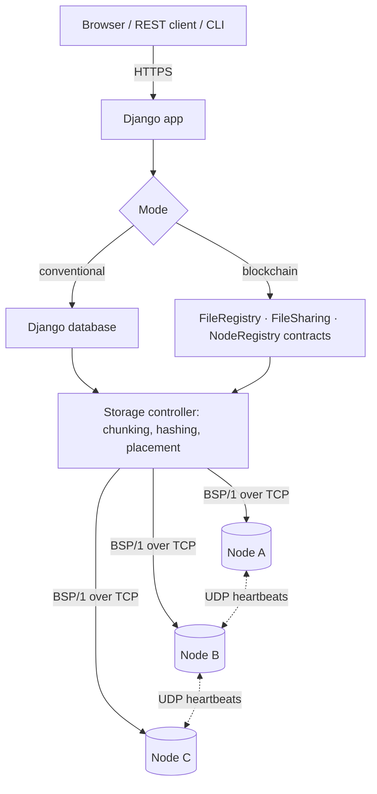

# BlockShare

BlockShare is a file-sharing system that stores files across a small cluster of storage nodes instead of on one server. Each upload is split into chunks, the chunks are hashed and replicated over the network, and a coordinator keeps track of who owns each file and who is allowed to read it.

The coordinator can be one of two things, and an administrator can switch between them while the system is running:

- **Conventional mode** — the Django server and its database decide ownership and permissions.
- **Blockchain mode** — Ethereum smart contracts decide. Each user signs their own transactions with a wallet that the app creates for them.

The storage layer is the same in both modes. Only the part that answers "who owns this, who can open it, which version is current" changes.

**Live demo:** https://blockshare-e16c.onrender.com — sign in as `alice`, `bob` or `charlie` with the password `blockshare123`. The demo runs on Render's free tier, so the first request after a quiet period can take up to a minute while the service wakes up, and demo data is reset whenever it restarts.

[](https://github.com/PragnyaKhandelwal/BlockShare/actions/workflows/ci.yml)

## About the project

This is our project-based learning (PBL) assignment for the 5th semester of B.Tech CSE at Jaypee Institute of Information Technology, Noida. The same project is submitted for three courses — Blockchain Development, Computer Networks and the Full Stack Development Lab (24B15CS314) — so each of those areas has a substantial part of the code and its own write-up in [`docs/`](docs).

Team (batch F-8): Pragnya Khandelwal, Pratishtha Singh and Ashu Gupta.

## How it works



When a file is uploaded, the server cuts it into fixed-size chunks (1 MB by default) and names each chunk by its SHA-256 hash. A consistent-hashing ring picks which nodes hold each chunk. The chunk is sent once to the first node, which forwards it to the next replica, and so on. The chunk hashes are combined into a Merkle root that identifies that exact version of the file. Finally, the file is registered with the active coordinator — as rows in the database, or as a `registerFile` transaction signed by the uploader.

On download, the coordinator checks the reader's permission and the registered Merkle root. Chunks are then fetched from the nodes in parallel. If a replica is missing or doesn't match its hash, the next replica is used and the bad one is repaired.

### Blockchain

Three contracts in [`blockchain/contracts`](blockchain/contracts), written in Solidity and tested with Hardhat:

- `FileRegistry` — file owners, the version history with a Merkle root per version, ownership transfer, and Merkle-proof verification of individual chunks.
- `FileSharing` — read and write grants, revocation, and permission checks.
- `NodeRegistry` — the list of storage nodes, so clients can find the data without the web server.

When the administrator turns blockchain mode on, existing files are anchored on-chain: owners, versions and grants are replayed as transactions. Files never go on-chain; only hashes and identifiers do. A small CLI ([`cli/blockshare_cli.py`](cli/blockshare_cli.py)) can download and verify a file using only the chain and the storage nodes, which shows that the system keeps working when Django is down. Details: [docs/BLOCKCHAIN.md](docs/BLOCKCHAIN.md).

### Computer networks

The storage nodes ([`storage_node/`](storage_node)) are asyncio servers that speak a binary protocol we designed, BSP/1. It uses a 72-byte header with length-prefixed framing, CRC-32 and an HMAC tag, and runs over TCP. Nodes send each other UDP heartbeats and spread membership by gossip. Each node also serves a small hand-written HTTP/1.1 status page. The server-side monitor measures round-trip times, marks unresponsive nodes as down, and re-replicates their chunks. From the admin screens you can crash a node or add latency to watch this happen. Details: [docs/COMPUTER_NETWORKS.md](docs/COMPUTER_NETWORKS.md).

### Full stack

The application is Django with Django REST Framework. It has server-rendered pages (dashboard, files, sharing, versions, transfers, nodes, chain explorer, control panel), a token-authenticated REST API documented at `/api/docs/`, and a service layer shared by the UI and the API. Tests run in GitHub Actions, and the app ships as a Docker image. Details: [docs/FULL_STACK.md](docs/FULL_STACK.md).

## Running it locally

You need Python 3.11 or newer and Node.js 18 or newer. Node is only used for the local Hardhat chain.

```bash
git clone https://github.com/PragnyaKhandelwal/BlockShare.git
cd BlockShare
python -m venv .venv
.venv\Scripts\activate          # on Linux/macOS: source .venv/bin/activate
pip install -r requirements.txt
cd blockchain && npm install && cd ..
python scripts/dev.py
```

`scripts/dev.py` starts these, all on your machine:

- a Hardhat chain on port 8545
- three storage nodes (TCP 9101–9103, UDP 10101–10103, HTTP 9301–9303)
- the node monitor
- Django at http://127.0.0.1:8000

The contracts are deployed automatically. The local admin login is `admin` / `admin12345`.

To run every component as its own host on a private Docker network (PostgreSQL, chain, three nodes, web and monitor), use:

```bash
docker compose up --build
```

To use real machines on a LAN, start a node on each one and add it from the Storage nodes page:

```bash
python -m storage_node --node-id node-b --port 9000 --advertise-host 192.168.1.102 --peers 192.168.1.101:10000 --cluster-key <shared secret>
```

## Restore an older file version

Open **My Files**, select a file, then select an older version in its version history.
As the owner, click **Restore vN** and confirm. BlockShare creates a new latest version
with the selected version's contents and a `Restored from vN` comment. All earlier
versions stay available. The page then displays the new latest version; click
**Download** to download the restored contents. Shared users also get those contents
when downloading the latest version.

If you only need a personal copy of an older version, download it directly instead.
Restoration reuses existing stored chunks and works in conventional and blockchain
modes. It fails if the source content is unavailable or fails integrity checks.

REST clients can use `POST /api/files/<file-id>/restore/` with `{"version": 1}`.
Only the owner can restore, and the selected version must not already be current.
The API returns the new version with HTTP 201.

## Deployment

The live demo is deployed on Render from [`render.yaml`](render.yaml). The [`Dockerfile`](Dockerfile) builds a single container that runs everything under supervisord: an Anvil chain, three storage nodes, the monitor, and Django behind Gunicorn. Any Docker host works the same way:

```bash
docker build -t blockshare .
docker run -p 8000:8000 -e SECRET_KEY=... -e ADMIN_PASSWORD=... blockshare
```

To use a public test network instead of the built-in chain, set `BLOCKCHAIN_RPC_URL`, `BLOCKCHAIN_OPERATOR_KEY` and `BLOCKCHAIN_EXPLORER_TX_URL`. [`.env.example`](.env.example) lists every setting.

## File sharing activity

On a file's details page, its current owner can open **Sharing activity** to see
who granted access, changed a permission, or revoked access, and when. Events are
shown newest first, with 25 per page. Repeating an unchanged permission does not
add another event. Shared readers and writers cannot view this history.

Events are recorded for successful sharing actions through the web UI and REST
API from the time this feature is installed; earlier changes and actions made
outside BlockShare are not reconstructed. Username snapshots remain readable
after an account is renamed or deleted. Existing version history continues to
show upload authors separately.

Apply the new database migration with `python manage.py migrate`. Owners can
also read paginated history at `GET /api/files/<file-id>/activity/` (standard
`limit` and `offset` parameters). This endpoint is read-only.

## Preview files

Open an owned or shared file and click **Preview vN** beside Download. The selected
version opens inside BlockShare, with a Back to file link and a Download fallback.
Supported formats are PNG, JPEG, GIF, WebP, PDF (using the browser's built-in viewer),
and small UTF-8 text files such as TXT, Markdown, CSV, JSON, code, and logs.

Previews are limited to 20 MiB, with a 1 MiB limit for text. Unsupported formats,
including Office documents, HTML, and SVG, retain the normal download option.
Text is escaped, and inline image/PDF types are selected from content signatures
rather than the uploaded MIME type. PDF display depends on browser support.

Every preview request uses the same permission, Merkle-root, and chunk verification
as downloading. Shared readers and writers can preview; revoked users cannot make
new preview requests. Responses are not cached. A preview still transfers content
to the browser and does not prevent saving or copying it.

Image/PDF page views inspect only the first verified chunk to identify the format.
The content endpoint streams verified chunks with a one-chunk fetch window and
reuses its signature chunk, instead of buffering the entire file. Text previews
remain buffered within the 1 MiB limit so they can be decoded and escaped safely.
Preview reads are excluded from transfer logs; ordinary downloads still create
their normal download records. If a later chunk becomes unavailable during a
stream, the response is interrupted rather than serving unverified content.

## Tests

The upload page displays bytes sent, average transfer speed, and approximate time
remaining for the browser-to-server transfer. Once that transfer completes, it
shows a separate processing stage until the server responds. Estimates reset on
failure and retry; server processing time is not included in the ETA.

The same **Start Upload** button changes to **Cancel Upload** while the browser
is sending the file, then to disabled **Processing…** once sending finishes.
Cancelling aborts that browser request, clears progress, and keeps the
selected file and comment available to upload again from the beginning. Late
events from the cancelled request cannot interfere with a retry. After cancellation
or an error, the button returns to **Start Upload** in the same location.

Cancellation is disabled once the browser finishes sending and server processing
starts. Aborting a browser request cannot undo work the server has already begun:
if the file had already reached the server, check **My Files** before retrying.
This control does not pause, resume, delete saved files, or cancel server-side work.

Run the upload progress and cancellation tests with `node --test tests/*.test.js`.

```bash
cd blockchain && npx hardhat test      # smart contracts
python manage.py test tests            # protocol, cluster, services, API, pages; blockchain mode if a chain is running
```

## Repository layout

| Path | Contents |
|---|---|
| `blockchain/` | Hardhat project: contracts, tests, deploy and ABI export scripts |
| `storage_node/` | storage node server, BSP/1 protocol and client |
| `storage/` | node registry, consistent-hash ring, storage controller, monitor |
| `coordination/` | coordinator interface, conventional and blockchain implementations, web3 client, Merkle tree |
| `files/`, `accounts/`, `core/` | data model, service layer, wallets, system settings |
| `api/`, `web/`, `templates/`, `static/` | REST API and web interface |
| `cli/` | command-line client that works without the web server |
| `docs/` | course reports and the demo walkthrough |
| `tests/` | Python test suite |

## License

MIT — see [LICENSE](LICENSE).
